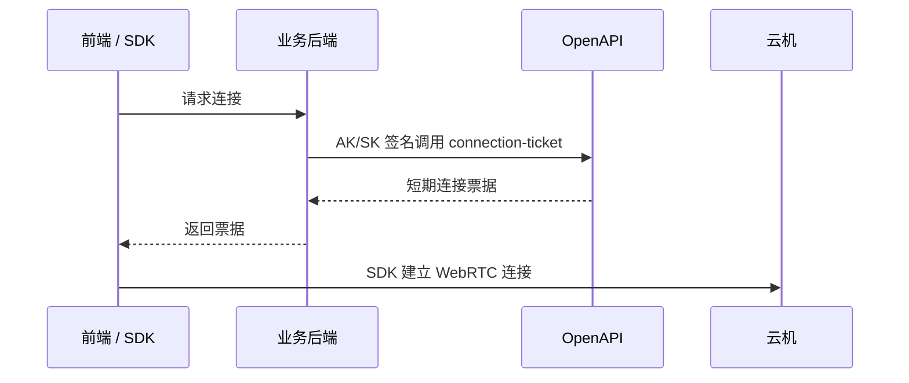

# WebRTC 单控教程

使用 [@vmaos/webrtc-sdk](https://www.npmjs.com/package/@vmaos/webrtc-sdk) 连接和控制云机。本目录为单控教程，使用 SDK **0.3.2**，支持本地摄像头按需传入云机。四种示例各自安装依赖、各自运行，可单独复制使用。多台云机同步操作请参阅 [WebRTC 群控教程](../webrtc-sdk-group-samples/README.md)。

**AK/SK 不能放到前端项目中，必须由业务后端调用 OpenAPI。前端只使用短期连接票据，不保存票据到 URL、日志或浏览器存储。**

## 选择示例

| 示例 | 说明 | 本地地址 |
| --- | --- | --- |
| [原生 H5](vanilla/README.md) | JavaScript / ESM | http://127.0.0.1:5174 |
| [React](react/README.md) | 组件挂载与卸载 | http://127.0.0.1:5175 |
| [Vue](vue/README.md) | Composition API | http://127.0.0.1:5176 |
| [script / IIFE](script/README.md) | script 标签加载 | http://127.0.0.1:5177 |

```bash
# 在教程代码根目录执行
cd webrtc-sdk-samples/react
pnpm install
npm run dev
```

需要 Node.js 24.15.0 或更高版本、pnpm 12.4.1。其他示例只需将 `react` 替换为对应目录。

也可在 WebRTC 示例根目录（`webrtc-sdk-samples`）一次启动四个示例：

```bash
pnpm install
pnpm run install:demos
npm run dev
```

`npm run dev` 是启动命令；按 Ctrl+C 停止。安装前请确认对应 SDK 的 0.3.2 版本已发布到 npm；各示例未提供锁文件，安装时会解析其公开依赖。

## 获取票据并连接



1. 业务后端校验用户与云机权限，调用 `POST /open-api/phone/connection-ticket`，请求体 `{"phoneCode":"云机编号"}`。签名规则见 Manage 的 API 概览。
2. 将完整成功响应 JSON 粘贴到示例页面，点击“连接云机”。票据短期有效且一次性使用，过期或重连时重新获取。
3. 连接后可操作画面、键盘、返回/主页/任务和音频；离开页面时释放连接。

示例的 JSON 输入框用于调试接入。实际产品应在点击连接时从自己的业务后端获取票据。

## 验证全部示例

在 WebRTC 示例根目录（`webrtc-sdk-samples`）执行：

```bash
pnpm install
pnpm run install:demos
pnpm test
pnpm build
pnpm exec playwright install chromium
pnpm run verify:browser
```

浏览器验证检查输入校验、SDK 初始化与销毁、摄像头状态与操作、安全提示和移动端布局；真实音视频连接需要有效云机票据。

## 摄像头教程

四个示例均包含独立的 `camera.js` 与界面控件，详见各自 README 的“本地摄像头”一节。在云机应用中打开摄像头后授权本地设备；页面显示采集状态，支持失败重试、关闭和前后切换。摄像头错误保留桌面连接，断开或离开页面时释放设备。

浏览器采集需 **HTTPS 或 localhost**，普通内网 IP HTTP 无法调用本地摄像头；iframe 需宿主允许 `camera`。SDK 只申请视频，不申请麦克风。自动浏览器验证使用事件和操作桩检查示例 UI，不连接实际云机、不代表摄像头端到端验收。

## 文本、粘贴和触控

四种示例均包含可独立复制的 `control.js` 和 `clipboard.js`，仅使用公开 SDK 导出。连接成功后，将鼠标移入云机画面，在云机文本框中输入；支持中文等输入法、普通字符、退格、回车和快捷键。Ctrl+V（macOS 为 Command+V）读取本机剪贴板的纯文本并发送到云机；图片、文件和富文本格式不作为粘贴内容发送。

### 云机文字复制到本机

在云机内选中文字并复制后，`clipboard.js` 监听公开 `WebRtcClient` 的 `EmitType.cloudClipData` 事件，尝试使用 `navigator.clipboard.writeText()` 写入本机剪贴板。`control.js` 通过公开的 `clientFactory` 挂载该处理，不依赖 SDK 私有字段，也不需要升级 SDK。

自动复制成功时不显示提示；Clipboard API 不可用或写入被拒绝时，顶部居中显示“云机文字待复制”。点击“复制到本机”后再在本机粘贴；仍失败时可点击“查看文字”选中原文手工复制。提示可以关闭，再次在云机复制时会按需重新显示。提示不挤占云机画面，断线、销毁或更换连接会移除提示和监听器，并丢弃旧异步结果。文字只保存在当前页面内存中，不写入日志、URL 或浏览器存储。

浏览器自动复制需要安全上下文（通常为 HTTPS 或 localhost），还受权限、页面焦点和用户激活限制；HTTPS 不保证自动复制一定成功。普通局域网 IP 的 HTTP 页面通常使用手动复制回退；按钮复制也可能被浏览器策略阻止，此时使用原文手工复制。

复制单个示例时必须同时保留 `control.js` 和 `clipboard.js`。可从本教程根目录运行 `pnpm run verify:clipboard` 验证四种单控示例的自动复制、手动回退、关闭和清理；验证使用已安装的真实 SDK、模拟云机事件，不代表真实云机端到端验收。

输入法组合过程不发送，中间 input 与候选确认后的重复事件会去重。离开画面、窗口失焦、隐藏页面或销毁时清理输入状态并结束触控；已建立连接在标签页隐藏时保留，退出页面或显式断开时才销毁。触控只接受视频内容区域，坐标按实际视频尺寸归一化，取消或失焦会发送抬起事件。

浏览器验证覆盖纯文本粘贴、输入法去重、功能按键、触控归一化、取消/失焦抬起、销毁后的输入隔离。摄像头的真实设备授权、视频和云机应用响应仍需真实环境验证。


## 滚轮与编程输入

四种示例均支持连接后在云机画面内使用滚轮，且不带动外层网页滚动；画面外正常滚动网页。四种教程的“滚轮与编程调用”包含 `sdk.click()`、`sdk.swipe()`、`sdk.drag()`、`sdk.scroll()` 用法及坐标、时长、取消和版本说明。本教程固定使用公开 npm SDK 0.3.2，已包含这些编程方法。


## 云机音量

四种示例均在三点“更多功能”菜单提供“音量加 / 音量减”与 `sdk.volumeUp()` / `sdk.volumeDown()` 用法，控制云机音量键，与开启/关闭音频传输独立。使用公开 SDK 0.3.2 的高层方法。具体说明见各示例“云机音量加减”。

## 连接画面与操作状态

四种示例的导航顺序统一为“最近任务、Home、返回、更多功能”；音量加减和静音/恢复收纳到三点菜单。连接前、连接中、断线时禁用控制，失去连接时收起菜单；同一连接恢复后保持音频状态，重连重新获取一次性票据。菜单支持点击外部或 Escape 收起，卸载后清理 DOM 和事件监听。

运行 `pnpm run verify:navigation` 验证四种示例的导航、音频切换、发送失败、断线恢复和卸载清理；`pnpm run verify:browser` 验证实际页面、键盘、触控、滚轮和已安装的公开 SDK。群控保持主控静音，并通过公开 `ControlGroupClient.sendData()` 同步输入与滚轮；可见截图、摄像头、剪贴板和各自重试见群控教程。自动验证使用模拟外部传输，不代表真实云机或物理摄像头已验收。
