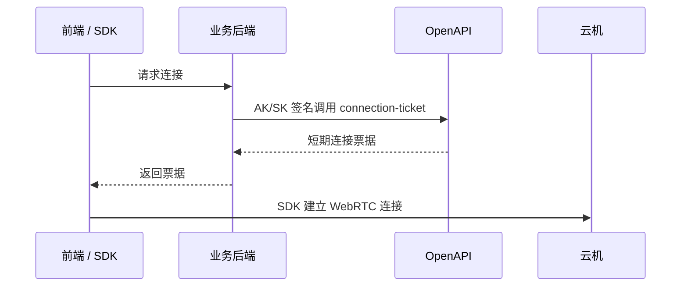

# WebRTC 单控教程

使用 [@vmaos/webrtc-sdk](https://www.npmjs.com/package/@vmaos/webrtc-sdk) 连接和控制云机。本目录为单控教程，使用 SDK **0.3.0**，支持本地摄像头按需传入云机。四种示例各自安装依赖、各自运行，可单独复制使用。多台云机同步操作请参阅 [WebRTC 群控教程](../webrtc-sdk-group-samples/README.md)。

**AK/SK 不能放到前端项目中，必须由业务后端调用 OpenAPI。前端只使用短期连接票据，不保存票据到 URL、日志或浏览器存储。**

## 选择示例

| 示例 | 说明 | 本地地址 |
| --- | --- | --- |
| [原生 H5](vanilla/README.md) | JavaScript / ESM | http://127.0.0.1:5174 |
| [React](react/README.md) | 组件挂载与卸载 | http://127.0.0.1:5175 |
| [Vue](vue/README.md) | Composition API | http://127.0.0.1:5176 |
| [script / IIFE](script/README.md) | script 标签加载 | http://127.0.0.1:5177 |

```bash
# 在教程代码根目录执行
cd webrtc-sdk-samples/react
pnpm install
npm run dev
```

需要 Node.js 24.15.0 或更高版本、pnpm 12.4.1。其他示例只需将 `react` 替换为对应目录。

也可在 WebRTC 示例根目录（`webrtc-sdk-samples`）一次启动四个示例：

```bash
pnpm install
pnpm run install:demos
npm run dev
```

`npm run dev` 是启动命令；按 Ctrl+C 停止。安装前请确认对应 SDK 的 0.3.0 版本已发布到 npm；各示例未提供锁文件，安装时会解析其公开依赖。

## 获取票据并连接



1. 业务后端校验用户与云机权限，调用 `POST /open-api/phone/connection-ticket`，请求体 `{"phoneCode":"云机编号"}`。签名规则见 Manage 的 API 概览。
2. 将完整成功响应 JSON 粘贴到示例页面，点击“连接云机”。票据短期有效且一次性使用，过期或重连时重新获取。
3. 连接后可操作画面、键盘、返回/主页/任务和音频；离开页面时释放连接。

示例的 JSON 输入框用于调试接入。实际产品应在点击连接时从自己的业务后端获取票据。

## 验证全部示例

在 WebRTC 示例根目录（`webrtc-sdk-samples`）执行：

```bash
pnpm install
pnpm run install:demos
pnpm test
pnpm build
pnpm exec playwright install chromium
pnpm run verify:browser
```

浏览器验证检查输入校验、SDK 初始化与销毁、摄像头状态与操作、安全提示和移动端布局；真实音视频连接需要有效云机票据。

## 摄像头教程

四个示例均包含独立的 `camera.js` 与界面控件，详见各自 README 的“本地摄像头”一节。在云机应用中打开摄像头后授权本地设备；页面显示采集状态，支持失败重试、关闭和前后切换。摄像头错误保留桌面连接，断开或离开页面时释放设备。

浏览器采集需 **HTTPS 或 localhost**，普通内网 IP HTTP 无法调用本地摄像头；iframe 需宿主允许 `camera`。SDK 只申请视频，不申请麦克风。自动浏览器验证使用事件和操作桩检查示例 UI，不连接实际云机、不代表摄像头端到端验收。
